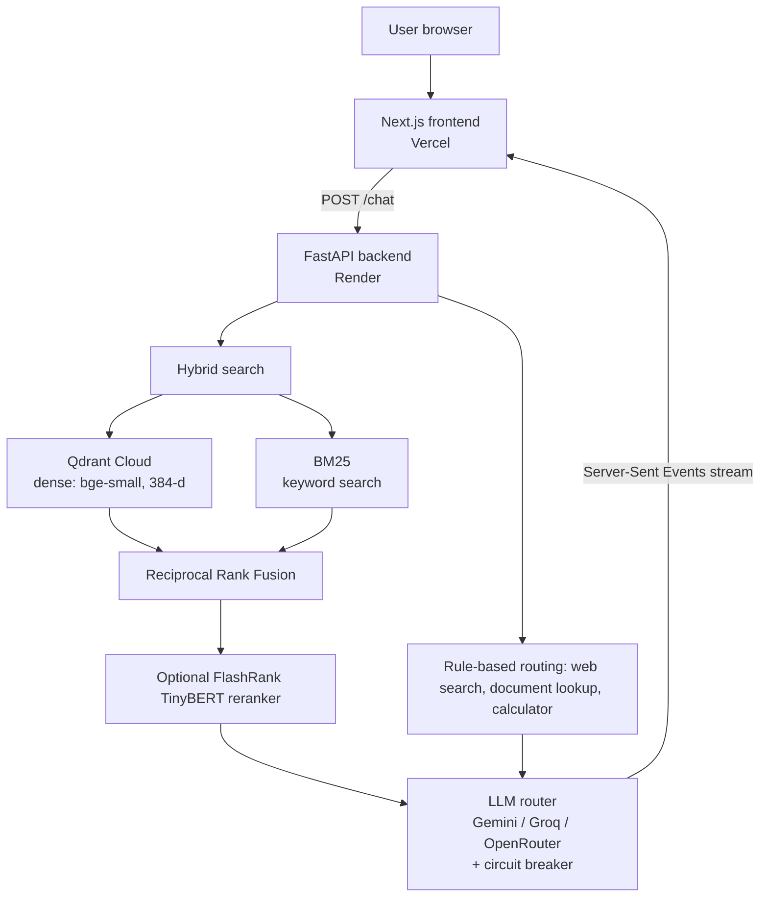

# Jruva - AI Assistant for Document Q&A

**Live:** [jruva.in](https://www.jruva.in) &nbsp;|&nbsp; **Retrieval benchmark:** [jruva-retrieval-eval](https://github.com/jasirjru/jruva-retrieval-eval)

> The free public demo runs on a 512 MB server: document uploads are off and search uses BM25 keyword retrieval there. The full pipeline below runs locally or on a larger instance.

Jruva is a public-beta AI assistant. You upload a document, ask a question, and it finds the most relevant passages and streams back an answer grounded in them (retrieval-augmented generation, RAG). It keeps answering when an LLM provider fails, and it can search the web or calculate when a question needs it.

## Architecture



## How a question is answered

1. **Ingest (on upload):** text is extracted per page and split into 250-word windows with a 50-word overlap (`backend/app/services/rag/document_rag.py`).
2. **Embed:** each chunk becomes a 384-dimension vector with `BAAI/bge-small-en-v1.5` (FastEmbed, ONNX on CPU), stored in Qdrant with cosine similarity. Repeated queries hit an LRU cache.
3. **Retrieve:** dense search (Qdrant) and BM25 each return their top 15. Results are merged with weighted Reciprocal Rank Fusion, `score = w / (k + rank + 1)` with `k = 20`, dense weight 1.0, BM25 weight 0.7 (`backend/app/services/rag/qdrant_vector_store.py`).
4. **Rerank (optional):** FlashRank `ms-marco-TinyBERT-L-2-v2` can re-order the candidates. It is off by default (`backend/app/core/config.py`) and is skipped on low-memory hosts such as the free 512 MB Render instance.
5. **Generate:** the best chunks and the question go to an LLM, and the answer streams to the browser with Server-Sent Events (`backend/app/api/v1/endpoints/chat.py`).

## Reliability: provider failover with a circuit breaker

The router (`backend/app/services/llm/router.py`, `circuit_breaker.py`) tries Gemini, Groq and OpenRouter. Each provider has a circuit breaker:

```
CLOSED --3 consecutive failures--> OPEN --15 s cooldown--> HALF_OPEN --2 successes--> CLOSED
                                     ^                         |
                                     +------any failure--------+
```

HTTP 429 (rate limit) marks a model `RATE_LIMITED`, so it is skipped during cooldown instead of making users wait.

## Tools (rule-based routing)

Tools are chosen by rules in the backend (intent patterns plus a user toggle for web search), not by LLM function calling.


- **Web search:** Tavily, falling back to DuckDuckGo, then Wikipedia (max 5 results; Tavily has its own 60 s breaker).
- **Calculator:** a restricted `ast`-based parser (`backend/app/services/image/safe_math.py`) that allows only numbers, `x`, `pi`, `e`, arithmetic and a whitelist of math functions, with length and node limits. It replaced an unsafe `eval()`; `backend/tests/test_safe_math.py` checks that correct math works and that injection strings such as `__import__('os')...` are rejected.
- **Answer styles:** four system-prompt personas (General, Architect, Elite Coder, Scholar) in `frontend/src/config/personas.ts`.

## Retrieval evaluation

A 100-question development set over 50 passages (90 answerable, scored; 10 unanswerable, not scored). Full tables and method: [docs/BENCHMARKS.md](docs/BENCHMARKS.md).

| Pipeline | Hit@1 | Hit@5 | MRR |
|---|---|---|---|
| Dense only (bge-small) | 83-84% | 100% | 0.91 |
| BM25 only | 74% | 90% | 0.81 |
| Hybrid (RRF) | 84% | 97% | 0.90 |
| Hybrid + reranker (one development run, reranker enabled) | 89% | 98% | 0.93 |

Honest notes:
- On this set, hybrid RRF did not beat dense-only on MRR. BM25 is kept for exact terms (codes, names, IDs, transliterated text) and as the fallback when local embeddings are disabled. The reranker result comes from a single development run; it is not part of the reproducible benchmark (where the reranker ran as a passthrough) and it is off in production.
- The question set is small, hand-built and was also used while tuning, so it is a development set, not a held-out test set. Refusal on the 10 unanswerable questions is not scored yet.
- On the free 512 MB Render instance, local embeddings are off by default to stay within memory, and search falls back to BM25.

## Tech stack

| Layer | Tools |
|---|---|
| Backend | Python, FastAPI, Pydantic, SQLAlchemy, Alembic, PostgreSQL |
| Retrieval | Qdrant, FastEmbed (bge-small-en-v1.5), BM25, RRF, FlashRank |
| LLMs | Gemini, Groq, OpenRouter |
| Frontend | Next.js, React, TypeScript |
| Quality | pytest, Ruff, GitHub Actions |
| Hosting | Render (API), Vercel (web), Qdrant Cloud (vectors) |

## Project layout

```
backend/
  app/
    api/v1/endpoints/   HTTP routes (chat streaming, uploads, health ...)
    services/rag/       chunking, embeddings, hybrid search, reranking
    services/llm/       provider clients, router, circuit breaker
    services/tools/     tool definitions (registry kept for future LLM function calling)
    core/               config, database, security
  tests/                pytest suite, incl. retrieval eval harnesses
  alembic/              database migrations
frontend/
  src/                  Next.js app, chat UI, streaming hook
docs/BENCHMARKS.md      retrieval benchmark details
.github/workflows/      CI: lint + migrations, backend tests, frontend build, audits
```

## Run locally

Requirements: Python 3.12, Node 20+.

```bash
# backend
cp backend/.env.example backend/.env      # add your own API keys
python -m venv .venv && source .venv/bin/activate   # Windows: .venv\Scripts\activate
pip install -r backend/requirements.txt
python run.py                              # API on http://localhost:8080

# frontend (second terminal)
npm --prefix frontend ci
npm --prefix frontend run dev              # UI on http://localhost:3000
```

Run the tests (about 1,490 backend tests, ~2.5 minutes; the first run downloads the bge-small embedding model once):

```bash
cd backend && python -m pytest tests -q --ignore=tests/load -k "not live and not locust"
npm --prefix frontend run test:unit
```

Security regression tests worth reading: `tests/test_calculus_engine_security.py` (math input can never execute code), `tests/test_circuit_breaker_probes.py` and `tests/test_rag_audit_fixes.py`.

## Security

- No secrets are committed. Copy `.env.example` and add your own keys.
- Provider errors are sanitized so API keys never reach logs or users (see `backend/tests/test_security_hardening.py`).
- The sample documents in `backend/data/sample_documents` and `frontend/public/samples` are synthetic.

## About this repository

Jruva has been developed privately since September 2026; this public repository is a clean snapshot of that code (history and internal notes removed, secrets replaced with placeholders). I built it with heavy use of AI coding assistants: I made the design decisions, tested, debugged and deployed it, and I can walk through any part of the code.

## Author

**Jasir Abdul Hameed**: [LinkedIn](https://www.linkedin.com/in/jasirjru) | [GitHub](https://github.com/jasirjru)
